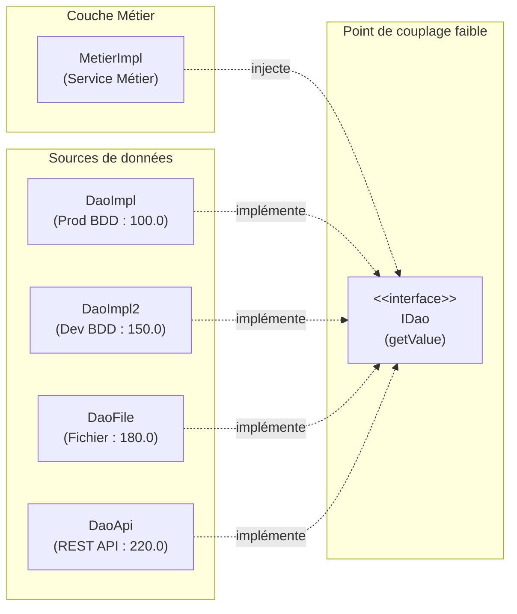

# TP 3 — Respect du principe Ouvert/Fermé (OCP) avec Spring IoC

> **ARCHITECTURE MICROSERVICES LAB**  
> Édition pédagogique : `TP3-SPRING-OCP-2026`

---

Ce laboratoire a pour objectif de maîtriser les mécanismes d'injection de dépendances de **Spring Framework** pour respecter strictement le **Principe Ouvert/Fermé (Open/Closed Principle - OCP)**. Vous y découvrirez comment basculer dynamiquement entre différentes sources de données sans **JAMAIS** modifier le code de la classe métier (`MetierImpl`).

---

## 📋 Table des matières

1. [Problème OCP & Solution Spring](#-problème-ocp--solution-spring)
2. [Architecture globale](#-architecture-globale)
3. [Structure du projet](#-structure-du-projet)
4. [Stratégies de résolution de l'ambiguïté](#-stratégies-de-résolution-de-lambiguïté)
   - [Stratégie A : Utilisation de @Primary](#stratégie-a--utilisation-de-primary)
   - [Stratégie B : Alias via @Bean](#stratégie-b--alias-via-bean)
   - [Stratégie C : Sélection dynamique par propriétés externes (Recommandée)](#stratégie-c--sélection-dynamique-par-propriétés-externes-recommandée)
   - [Stratégie Profils : Activation par environnement (@Profile)](#stratégie-profils--activation-par-environnement-profile)
   - [Extension : Injection multiple (List & Map de DAOs)](#extension--injection-multiple-list--map-de-daos)
5. [Compilation et exécution](#-compilation-et-exécution)
6. [Tests de non-régression](#-tests-de-non-régression)

---

## 🎯 Problème OCP & Solution Spring

- **Problème initial :** Si `MetierImpl` instancie ou référence directement une implémentation concrète (ex: `DaoImpl`), tout changement de source (passage en dev, fichier local ou API REST) impose de modifier le code de `MetierImpl`. Cela viole le principe OCP (*ouvert à l'extension, fermé à la modification*).
- **Solution Spring IoC :** `MetierImpl` dépend uniquement de l'interface `IDao` via l'**injection par constructeur**. Le conteneur IoC se charge d'injecter la bonne implémentation selon la configuration externe.

---

## 📐 Architecture globale



---

## 📁 Structure du projet

```text
TP 3/
├── pom.xml                                      # Dépendances Maven (spring-context 5.3.30, javax.annotation-api, JUnit)
├── README.md                                    # Documentation du TP
├── .project / .classpath / .gitignore           # Métadonnées Eclipse & Git
└── src/
    ├── main/
    │   ├── java/
    │   │   ├── dao/
    │   │   │   ├── IDao.java                    # Contrat d'interface
    │   │   │   ├── DaoImpl.java                 # BDD Prod (100.0)
    │   │   │   ├── DaoImpl2.java                # BDD Dev (150.0)
    │   │   │   ├── DaoFile.java                 # Fichier local (180.0)
    │   │   │   ├── DaoApi.java                  # API REST (220.0)
    │   │   │   └── DaoImplProd.java             # Démonstration @Profile("prod")
    │   │   ├── metier/
    │   │   │   ├── IMetier.java                 # Interface Métier
    │   │   │   ├── MetierImpl.java              # Service avec injection par constructeur & @PostConstruct
    │   │   │   └── MetierMultiple.java          # Service avec List<IDao> et Map<String, IDao>
    │   │   ├── config/
    │   │   │   ├── AppConfig.java               # Scan des composants & @PropertySource
    │   │   │   ├── DaoAliasConfig.java          # Stratégie B (@Bean alias)
    │   │   │   └── DynamicDaoConfig.java        # Stratégie C (@Value("${dao.target}") dynamique)
    │   │   └── Main.java                        # Point d'entrée de l'application
    │   └── resources/
    │       └── app.properties                   # Configuration externe (dao.target=dao2)
    └── test/
        └── java/
            └── test/
                └── OcpSelectionTest.java        # Tests unitaires et d'intégration
```

---

## ⚙️ Stratégies de résolution de l'ambiguïté

Lorsque 4 implémentations de `IDao` sont présentes, Spring lève par défaut une exception `NoUniqueBeanDefinitionException`. Voici les stratégies mises en œuvre pour la résoudre :

### Stratégie A : Utilisation de `@Primary`
- Annotation directe `@Primary` sur une classe annotée `@Component` (ex: `DaoImpl`).
- **Avantage :** Simple à mettre en place.
- **Limite :** Statique ; changer de cible nécessite de modifier le code Java et recompiler.

### Stratégie B : Alias via `@Bean`
- Définition d'un `@Bean` annoté `@Primary` dans une classe `@Configuration` (`DaoAliasConfig`).
- Permet de rediriger `IDao` vers `new DaoApi()` sans modifier les classes DAO ni `MetierImpl`.

### Stratégie C : Sélection dynamique par propriétés externes (Recommandée en Production)
Dans `src/main/resources/app.properties` :
```properties
dao.target=dao2
```

Dans `config.DynamicDaoConfig` :
```java
@Configuration
public class DynamicDaoConfig {
    @Value("${dao.target:dao2}")
    private String daoTarget;

    @Bean
    @Primary
    public IDao dynamicDao() {
        switch (daoTarget) {
            case "dao": return new DaoImpl();
            case "dao2": return new DaoImpl2();
            case "daoFile": return new DaoFile();
            case "daoApi": return new DaoApi();
            default: throw new IllegalArgumentException("Cible DAO inconnue: " + daoTarget);
        }
    }
}
```
**Bascule instantanée :** En modifiant simplement `dao.target` dans `app.properties` :
- `dao.target=dao` $\rightarrow$ $100.0 \times 2 = 200.0$
- `dao.target=dao2` $\rightarrow$ $150.0 \times 2 = 300.0$
- `dao.target=daoFile` $\rightarrow$ $180.0 \times 2 = 360.0$
- `dao.target=daoApi` $\rightarrow$ $220.0 \times 2 = 440.0$

### Extension : Injection de plusieurs DAOs
Dans `metier.MetierMultiple`, Spring injecte simultanément :
- `List<IDao>` : Tous les beans de type `IDao`.
- `Map<String, IDao>` : Les beans indexés par leur nom (`"dao"`, `"dao2"`, `"daoFile"`, `"daoApi"`).

---

## 🚀 Compilation et exécution

### Depuis le terminal PowerShell dans `TP 3` :

1. **Lancer les tests de non-régression :**
   ```powershell
   mvn clean test
   ```

2. **Lancer l'application (`Main.java`) :**
   ```powershell
   mvn exec:java "-Dexec.mainClass=Main"
   ```

**Sortie console obtenue :**
```text
[TRACE] Implémentation DAO injectée : DaoImpl2
[DAO] Lecture depuis la base de données (dev)
Résultat final : 300.0
```

---

<div align="center">

`ARCHITECTURE MICROSERVICES LAB · TP3-SPRING-OCP-2026`

*Respecter le principe Open/Closed grâce à l'inversion de contrôle Spring.*

</div>
